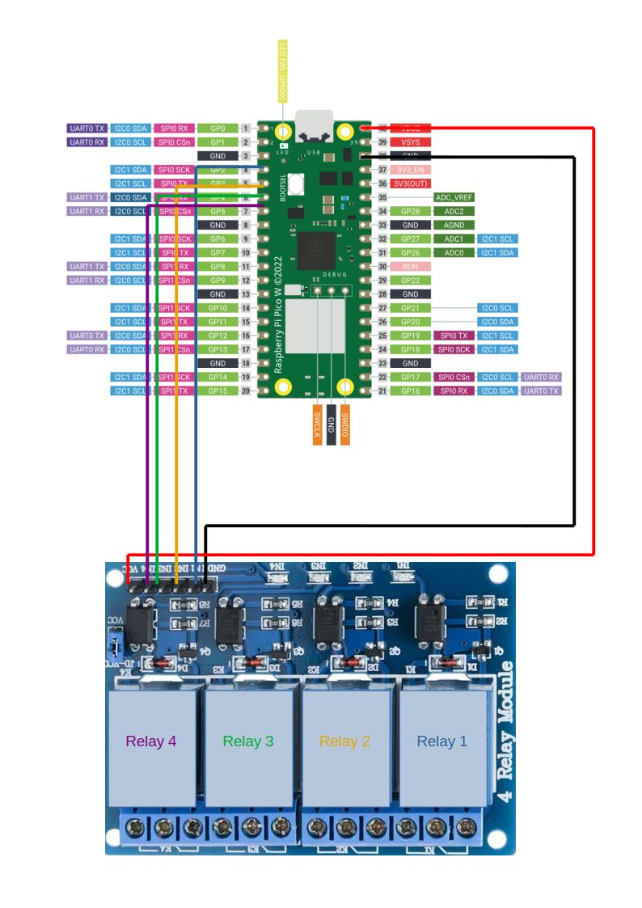

# Relay Control

---

Control a simple 4 relay module connected to a host via usb.  Copy the main.py file to the pico, connect the relay module,
and then run the host code to control the relays.

The example host code has been tested on Debian based hosts- it assumes the pico corresponds to device "/dev/ttyACM0",
though this may not always be the case and udev rules may be needed.  Modify to fit the use case.

(Image Credit: [raspberrypi.com](https://www.raspberrypi.com/documentation/microcontrollers/pico-series.html#pico-1-family))



---

```python3
import serial
import time


class RelayController:
    def __init__(self, port="/dev/ttyACM0"):
        self.ser = serial.Serial(
            port=port,
            baudrate=115200,
            timeout=2,
            write_timeout=2
        )

        # Wait USB connection.
        time.sleep(1)

        # Ignore startup messages.
        self.ser.reset_input_buffer()

    def command(self, cmd):
        """Send a command to the Pico and return its response."""
        self.ser.write((cmd + "\n").encode("ascii"))
        self.ser.flush()

        response = self.ser.readline().decode(
            "ascii", errors="replace"
        ).strip()

        if not response:
            raise TimeoutError(f"No response from Pico: {cmd}")

        if response.startswith("ERR"):
            raise RuntimeError(response)

        return response

    def on(self, relay):
        return self.command(f"RELAY {relay} ON")

    def off(self, relay):
        return self.command(f"RELAY {relay} OFF")

    def toggle(self, relay):
        return self.command(f"TOGGLE {relay}")

    def all_on(self):
        return self.command("ALL ON")

    def all_off(self):
        return self.command("ALL OFF")

    def status(self):
        return self.command("STATUS")

    def close(self):
        self.ser.close()

    def __enter__(self):
        return self

    def __exit__(self, exc_type, exc_value, traceback):
        self.close()

relay_module = RelayController()

relay_module.all_on()
time.sleep(1)
relay_module.all_off()

relay_module.on(1)
time.sleep(1)
relay_module.off(1)

```